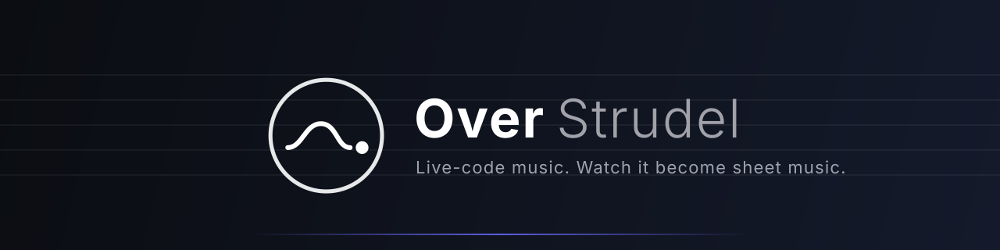
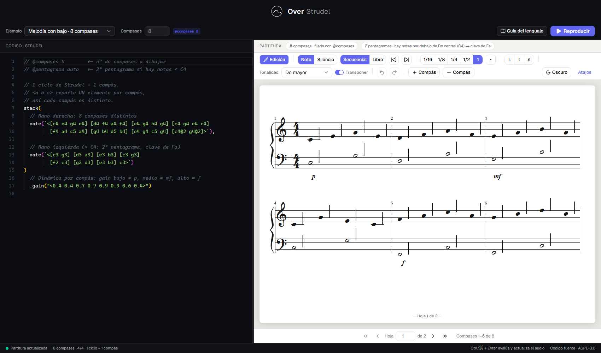
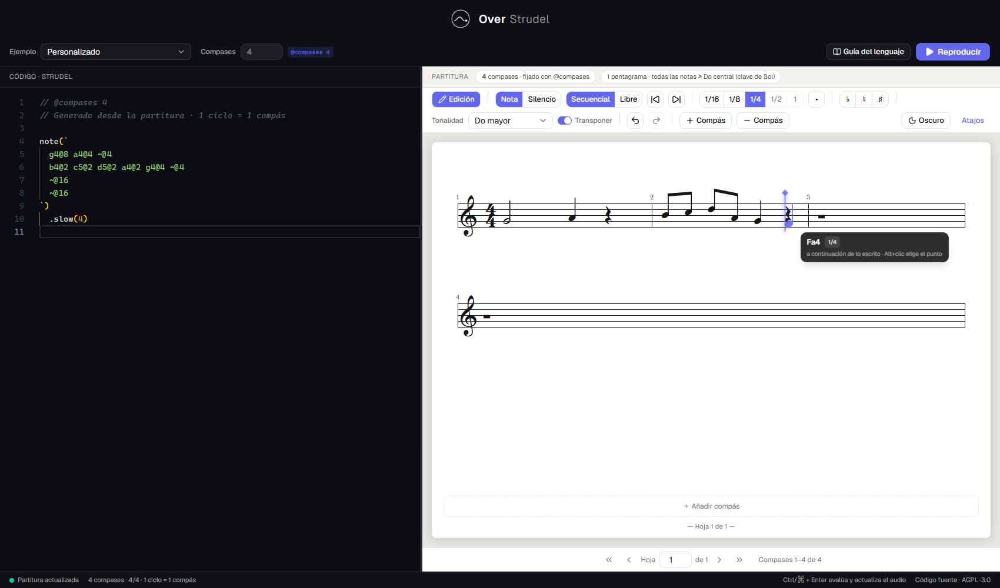
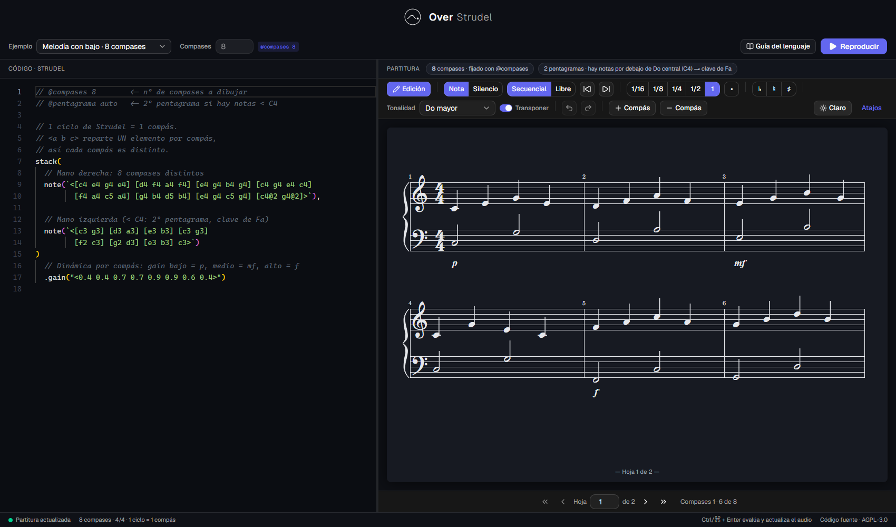
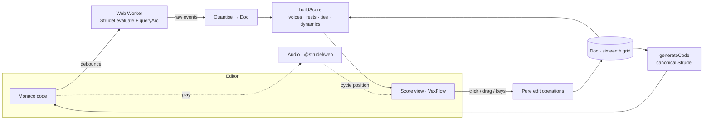

<div align="center">



# Over Strudel

**Live-code music with [Strudel](https://strudel.cc) and watch it become sheet music in real time.**
Edit the score and the code rewrites itself.

[](LICENSE)
[](https://nextjs.org)
[](https://www.typescriptlang.org)
[](#testing)

</div>

---

Over Strudel closes a gap between two worlds. Reactive live-coding languages such as Strudel and TidalCycles are great at
describing music algorithmically, but they only give you sound or a piano roll. Notation editors (VexFlow, LilyPond, ABC)
draw beautiful scores, but they need every note typed by hand and have no loops, probability or maths. Desktop tools that
combine both (Opusmodus, OpenMusic) are heavy and expensive.

Over Strudel puts them in one browser tab: a Monaco editor on the left, a live engraved score on the right, and a
**bidirectional link** between them. Change a variable and the staff redraws. Click a note on the staff and the code is
rewritten, with every measure still adding up exactly.

<p align="center">
  
</p>

## Features

- **Live notation** — Strudel patterns are evaluated in an isolated Web Worker and engraved with VexFlow as you type
  (debounced hot reload). The UI thread only handles interaction and drawing.
- **Time quantisation** — Strudel's continuous, fractional event stream is snapped to a rigid 4/4 sixteenth-note grid:
  measures, Western note values, ties across barlines, chords, polyphonic voices and rests.
- **Bidirectional editing** — the score and the code are *the same document*. Place, move, resize, transpose and delete
  notes on the staff; the code is regenerated in a canonical form and re-evaluated to prove it plays exactly what you see.
- **Sequential note entry** — each measure starts as a whole-note rest; every click writes the *next* note or rest, in
  order. Free space is always shown as the subdivision you expect (half rest, quarter rest…), never as stray eighths.
  Notes and rests share the same flow and you can switch at any moment (`R`).
- **Key signatures** — pick a key and the signature is drawn on every system with correct spelling (B♭ in F major).
  Optionally transpose the whole piece to the new key.
- **Dynamics and articulations** — `gain` becomes *p / mf / f*, `clip` becomes staccato / tenuto, both editable on the staff.
- **Paginated sheets** — the score fills the whole panel and is split into sheets that follow the window size, with a
  pager and automatic page turns during playback.
- **Playback with a score cursor** — audio through `@strudel/web`; a cursor sweeps the staff, sounding notes light up and
  the matching tokens are highlighted in the code editor.
- **Light and dark score** — plus a themed, accessible component set (shadcn/ui on Base UI) that adapts to both modes.
- **Self-hostable** — standalone Next.js build, Dockerfile + Nginx, or PM2 behind your own reverse proxy.

<table>
  <tr>
    <td width="50%"></td>
    <td width="50%"></td>
  </tr>
  <tr>
    <td align="center"><sub>Sequential entry: notes and rests written one after another, with the input cursor and a live preview</sub></td>
    <td align="center"><sub>Dark score, grand staff, dynamics</sub></td>
  </tr>
</table>

## Quick start

Requirements: **Node.js ≥ 20.9** and npm.

```bash
git clone https://github.com/crm107-ua/over-strudel.git
cd over-strudel
npm install
npm run dev          # http://localhost:3000
```

Press **▶ Reproducir** to hear it, or edit the example and watch the score follow.

> The interface is currently in Spanish. The documentation is in English.

### With Docker

```bash
docker compose up -d --build   # Nginx on http://localhost:80 in front of the Next.js app
```

## How the code becomes a score

In Strudel everything is measured in **cycles**. Over Strudel engraves **one cycle as one 4/4 measure**. The code does
not "know" how many measures there are: `note("c4 e4 g4 c5")` lasts one cycle and Strudel repeats it forever, so the app
looks at the first *N* cycles and draws each one.

```js
// @compases 8          // draw 8 measures
// @pentagrama auto     // 2nd staff only if a note is below middle C
// @tonalidad G         // G major key signature

stack(
  // <a b c> gives ONE element per measure, so every measure is different
  note(`<[c4 e4 g4 e4] [d4 f4 a4 f4] [e4 g4 b4 g4] [c4 g4 e4 c4]
         [f4 a4 c5 a4] [g4 b4 d5 b4] [e4 g4 c5 g4] [c4@2 g4@2]>`),
  note(`<[c3 g3] [d3 a3] [e3 b3] [c3 g3] [f2 c3] [g2 d3] [e3 b3] c3>`)
).gain("<0.4 0.4 0.7 0.7 0.9 0.9 0.6 0.4>")
```

| Directive (a `//` comment) | Meaning |
| --- | --- |
| `// @compases N` | Number of measures to draw (1–64). Overrides the *Compases* field. |
| `// @pentagrama auto \| piano \| sol` | Grand staff only when needed / always / never. |
| `// @tonalidad G` | Key signature: `C G D A E B F# C# F Bb Eb Ab Db Gb Cb` and minors with `m` (`Am`, `F#m`…). |

The full language reference and the keyboard map are in the **[User guide](docs/USER_GUIDE.md)** (also available inside
the app under *Guía del lenguaje*).

## Editing the score

The score editor works in two entry modes:

| | **Sequential** (default) | **Free** |
| --- | --- | --- |
| Click | writes the next note/rest at the input cursor of the measure you click | places the note where you click |
| Duration | from the toolbar (`1`–`5`, `.`); never crosses the barline, shrinks to what is left | same, or drag horizontally to draw the length |
| Rests | **Rest mode** writes rests exactly like notes (`R` switches, `Enter` writes at the cursor) | click in rest mode |
| Cursor | `Alt`+click moves it (and then overwrites from there) | — |

Common to both: click a note to select it (a floating menu appears), drag to move, **mouse wheel** over a note to change
its pitch, right-click or `Del` to delete, `Ctrl+Z / Ctrl+Y` to undo/redo. A full measure never accepts more notes and
**measures are never created implicitly**: use *＋ Compás*.

## Architecture in one picture



The document model, the canonical code format and the design decisions are described in
**[docs/ARCHITECTURE.md](docs/ARCHITECTURE.md)**.

## Scripts

| Command | What it does |
| --- | --- |
| `npm run dev` | Development server on port 3000 |
| `npm run build` | Production (standalone) build; copies the static assets next to `server.js` |
| `npm start` | Runs the standalone server (`node .next/standalone/server.js`) |
| `npm run lint` / `npm run typecheck` | ESLint / TypeScript |
| `npm test` | Unit and integration tests (Vitest, with the **real** Strudel engine) |
| `npm run test:e2e` | Browser end-to-end checks against a running server |

## Testing

- **Pure operations** (`src/lib/edit`) are unit-tested, including invariants such as *"any sequence of edits leaves every
  measure complete"*.
- **Round trips through the real Strudel engine**: random documents → generated code → Strudel → document must be
  identical, and regenerating the code must reproduce the same text.
- **Store fuzzing** (`src/store`): sessions of random actions (add, move, enter notes and rests, change key, undo…) where,
  after every step, the code on screen evaluated by Strudel must reproduce the score exactly.
  `FUZZ_SESSIONS=60 npx vitest run src/store` for a heavier run.
- **End-to-end** (`e2e/editor.mjs`, Playwright driving a real Chrome): clicks, keyboard, drag, undo, sequential entry,
  pagination, key changes, playback and themes — 93 checks.

```bash
npm run dev &                                   # or docker compose up -d --build
npm run test:e2e -- http://localhost:3000 "/path/to/chrome"
```

## Deployment

Docker, and a PM2 + Nginx setup for a plain Linux server, are documented in **[docs/DEPLOYMENT.md](docs/DEPLOYMENT.md)**.
`ecosystem.config.cjs` describes the PM2 process (standalone server on port 4244, bound to `127.0.0.1`).

## Known limitations

- Only 4/4. Tuplets and irregular subdivisions are rounded to the sixteenth grid.
- Unpitched sounds (drums) are not notated.
- Editing from the staff rewrites the code in its canonical form (`every()`, functions… are not preserved; undo restores them).
- A chord shares one dynamic and one articulation.
- Accidentals are spelled by key (flats in flat keys, sharps otherwise); white keys are never renamed (E♯ shows as F).

## Contributing

Issues and pull requests are welcome — see **[CONTRIBUTING.md](CONTRIBUTING.md)**. Release notes are in
[CHANGELOG.md](CHANGELOG.md).

## License

Over Strudel is free software under the **GNU Affero General Public License v3.0 or later** — see [LICENSE](LICENSE).

It builds on [Strudel](https://codeberg.org/uzu/strudel), which is AGPL-3.0-or-later, so the whole application is
distributed under the same terms. If you run a modified version as a network service you must offer its source code to
its users; the app footer links to the source for that reason.

## Acknowledgements

[Strudel](https://strudel.cc) and the TidalCycles community · [VexFlow](https://www.vexflow.com) ·
[Monaco Editor](https://microsoft.github.io/monaco-editor/) · [shadcn/ui](https://ui.shadcn.com) and
[Base UI](https://base-ui.com) · [Zustand](https://zustand-demo.pmnd.rs) · [Lucide](https://lucide.dev) ·
[Next.js](https://nextjs.org)
